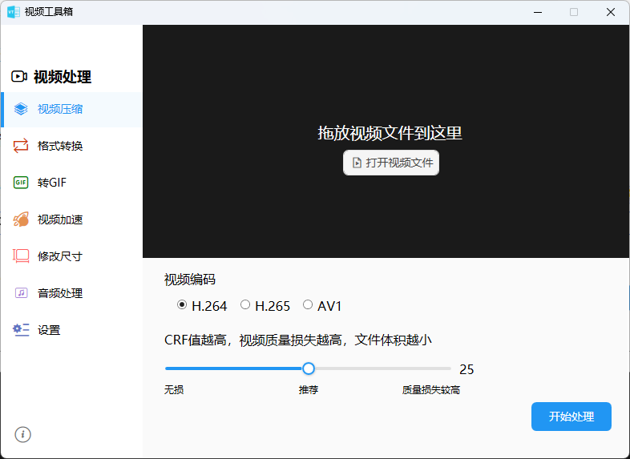
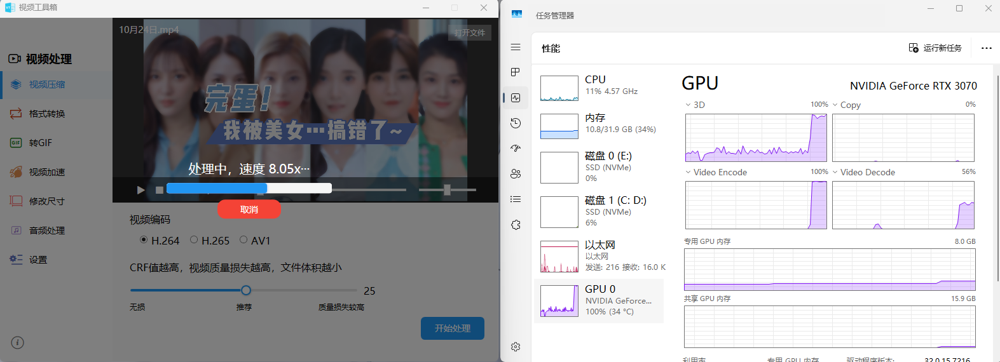
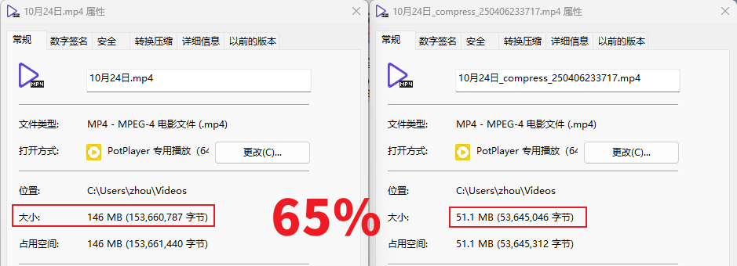

# VideoTools

## 简介

VideoTools 是一个用于视频处理的轻量工具集。  
目标是“小而美”，覆盖高频需求：压缩、格式转换、裁剪、转 GIF 等。  
软件体积小，无需安装，开箱即用。工具虽小，“五脏俱全”！
> 本工具依赖 FFmpeg 提供的视频处理能力。可在设置界面选择 FFmpeg 路径，也支持在线下载（推荐版本可直接下载）。  



## 使用

- 首次启动会提示选择 FFmpeg 程序路径：可以自行下载，也可以直接在线下载（设置页提供）。
- 选择输出目录，导入视频（拖拽文件或“打开文件”）。
- 若视频无法预览（系统编解码器限制），仍可继续压缩/转换/裁剪等处理，界面会弹出提示说明。
- 在左侧功能区选择需要的功能，调整参数后点击“开始处理”。

## 功能

- 视频压缩（支持 CPU 与 Intel/Nvidia/AMD 硬件编码）
- 格式转换（支持目标格式：`mp4 / avi / mkv`）
- 裁剪（`-ss` + `-t`，默认无重编码 `-c copy`，快速处理）
- 转 GIF（支持 `fps/scale`，可选 `palettegen/paletteuse` 与循环）
- 视频倍速（加速/减速）
- 修改尺寸（缩放到指定宽高）
- 音频处理（提取音频或删除音轨）

## MCP 与 CLI 自动化

除图形界面外，本仓库新增了两条自动化通道，与界面共用同一套 ffmpeg 参数与配置：

- `videotools.exe`：命令行工具，适合终端脚本与 CI
- `videotools-mcp.exe`：MCP stdio 服务，可被 Cursor、Claude Code、Codex 等 AI 工具直接调度

覆盖能力：媒体探测、压缩、格式转换、裁剪、GIF/WebP、倍速、改尺寸、音频提取/去除/替换、批处理、多步流水线、任务查询与取消、配置读写、编码器检测、环境自检（共 20 个 MCP 工具）。

### 构建

```powershell
powershell -ExecutionPolicy Bypass -File .\build.ps1 -DownloadRoslyn
```

使用 Visual Studio 2022 自带的 MSBuild 时无需 Roslyn 参数。构建产物位于 `VideoTools\bin\Release\`，自动化程序在 `automation\` 子目录。

### 便携版

```powershell
powershell -ExecutionPolicy Bypass -File .\build.ps1 -Portable -FfmpegPath "D:\ffmpeg\ffmpeg.exe"
```

生成 `dist\VideoTools-Portable\`，内含主程序、`automation\`、`ffmpeg.exe` 以及 `data\` 配置目录。整个文件夹拷到 U 盘或另一台 Windows 10/11 电脑即可直接使用：设置与任务记录都写在 `data\` 里，不写入用户目录；`data\config.ini` 中的 ffmpeg 使用相对路径 `ffmpeg.exe`。

### 连接 AI 工具

界面左侧「AI 自动化」面板可一键复制 Cursor / Claude / Codex 配置，也可以直接使用命令：

```powershell
videotools setup mcp --client claude --install   # 直接注册到 Claude Code
videotools setup mcp --client cursor             # 输出 JSON，粘贴到 mcpServers
videotools setup mcp --client codex              # 输出 TOML 片段
```

### 常用命令

```powershell
videotools probe "D:\video.mp4"
videotools compress "D:\video.mp4" --codec h265 --crf 28 --gpu nvenc --output-dir "D:\out"
videotools convert "D:\video.mp4" --format mkv
videotools trim "D:\video.mp4" --start 00:00:05 --duration 10
videotools gif "D:\video.mp4" --fps 12 --width 480
videotools speed "D:\video.mp4" --rate 1.5
videotools resize "D:\video.mp4" --width 1280
videotools audio "D:\video.mp4" --action extract --format mp3
videotools batch --files a.mp4,b.mp4 --operation compress --params '{\"crf\":30}'
videotools pipeline --input-json steps.json
videotools jobs list
videotools doctor
```

> PowerShell 中 JSON 参数必须用单引号包裹，且内部双引号写成 `\"`，否则会被 shell 吞掉导致解析失败。

长任务可加 `--async`，随后用 `videotools jobs get --id <任务ID> --wait` 查询；MCP 工具默认等待完成，也可传 `wait:false` 立即拿到任务 ID。

ffmpeg 查找顺序：`--ffmpeg` 参数 → 环境变量 `VIDEOTOOLS_FFMPEG` → 界面设置中的路径 → 程序目录 → PATH（配置里的相对路径按程序目录解析）。自动化与界面共用同一份配置：默认写在程序目录下 `data\config.ini`（便携模式）；程序目录不可写时回退到 `%APPDATA%\.VideoTools_250405`。

## 支持的输入格式

常见容器均可识别导入（预览可能受系统编解码器限制，但处理端依赖 FFmpeg 不受限）：
`mp4, avi, wmv, mov, mkv, webm, flv, ts, m2ts, mts, mpg, mpeg, m4v, 3gp, 3g2, ogv, ogg, vob, asf, mxf, rmvb, rm, y4m`

## GPU 加速支持情况

- 支持 Intel / AMD / Nvidia 硬件编码（如 `h264_qsv / h264_nvenc / h264_amf`）。
- 为提升兼容性，工具不强制“解码”硬件加速，仅在“编码端”使用 GPU。
- 若启用 GPU 压缩，码率会按分辨率估算；当预览失败无法获取分辨率时，程序会回退到合理基准，避免 `-b:v 0M` 导致失败。
- 若硬件编码失败（驱动/设备限制），可关闭 GPU 选项，使用 CPU 编码（如 `libx264`）。

提示：目标格式为 `avi` 时默认映射为更通用的 `mpeg4 + libmp3lame`，避免 AV1 硬件编码器不可用导致失败。

## 测试

### 测试环境

- 测试环境：Windows 11
- 测试设备：Intel i7-10700KF+RTX3070
- 测试视频：2560x1440 2K

### 测试结果

- 测试结果：体积减小65%
- 耗时：≈13s





## 编译环境

- Visual Studio 2022
- .Net 4.8

## 配置文件

用户配置文件默认保存在程序目录下的 `data\config.ini`（便携模式，含 FFmpeg 路径、GPU 选项、输出目录等设置），任务记录在同级 `data\jobs\`。
若程序目录不可写（例如装在 `C:\Program Files`），会自动回退到用户目录 `AppData\Roaming\.VideoTools_250405`；首次以便携模式运行时会自动复制旧配置。
## 裁剪与 GIF 使用提示

- 裁剪默认使用无重编码（`-c copy`），起止点以关键帧为准；如需帧级准确裁剪可改为重新编码方案（后续可扩展）。
- 时间区间可通过文本框或上下按钮微调，滑块与文本框双向同步。
- GIF 可选调色板生成与使用（`palettegen/paletteuse`）以提升色彩效果；支持设置 `fps` 与 `scale`。

## 常见问题

- 路径或文件名包含空格：已在命令中为路径加引号，处理正常。
- 视频无法预览：不影响处理；请直接设置参数并“开始处理”。
- 处理失败：优先尝试关闭 GPU 加速，确认 FFmpeg 程序路径可执行；并检查输出目录可写。
